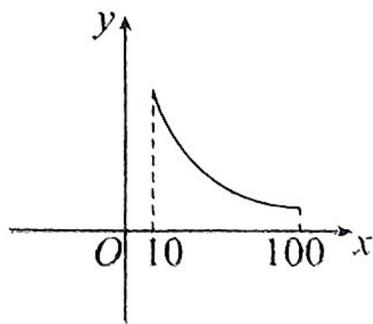

<!-- question-source:start -->
6 某学校要种植一块面积为 $200 \, m^{2}$ 的长方形草坪, 要求两邻边长均不小于 $10 \, m$ , 求草坪的一边 y (单位: m) 随另一边 x (单位: m) 的变化而变化的图象. 王千同学所画图象如图所示. 其所画图象是否正确? 若不正确, 请说明原因并画出正确的图象.

<!-- question-source:end -->

![[Q00108308A1]]
