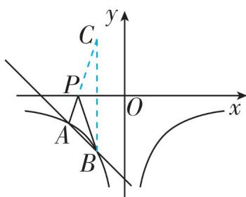

> [!success]- 必刷题
>
> > [!success] **【答案】** 详见解析
>
> > [!note]- **【解析】**
> > 【解】(1)∵点 $(a,-1)$ ， $(a-1,-2)$ 在反比例函数 $y=\frac{k}{x}(k\neq0)$ 的图象上，∴k=-a=-2(a-1)，解得a=2，则 $k=2\times(-1)=-2$ .
> >
> > (2)由(1)知,反比例函数的表达式为 $y=-\frac{2}{x}$ ,
> > 则将反比例函数 $y=\frac{k}{x}$ 的
> >
> > 
> >
> > 图象中 x 轴上方部分沿 x 轴翻折得到的图象的函数表达式为 $y=\frac{2}{x}(x<0)$ . 联立 $y=\frac{2}{x}(x<0)$ 和 $y=-x+b$ 并整理得 $x^{2}-bx+2=0$ , 则 $x_{1}+x_{2}=b, x_{1}x_{2}=2.$ $\because x_{1}<x_{2}<0, x_{1}=2x_{2}, \therefore 2x_{2}\cdot x_{2}=2, \therefore x_{2}=-1$ , 则 $x_{1}=-2$ , 即点 A, B 的坐标分别为 $(-2,-1), (-1,-2)$ . 如图, 作点 B 关于 x 轴的对称点 $C(-1,2)$ , 连接 AC 交 x 轴于点 P, 此时 AP+BP 的值最小, AC 的长为最小值. 设 AC 所在直线的表达式为 $y=mx+c$ , 则 $\left\{\begin{aligned}-2m+c&=-1,\\-m+c&=2,\end{aligned}\right.$ 解得 $\left\{\begin{aligned}m&=3,\\c&=5,\end{aligned}\right.$ 则 AC 所在直线的表达式为 $y=3x+5$ . 当 y=0 时, $x=-\frac{5}{3}$ , 即点 P 的坐标为 $\left(-\frac{5}{3},0\right)$ .
