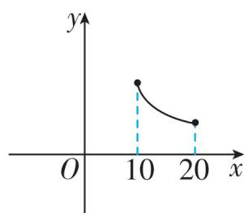

> [!success]- 必刷题
>
> > [!success] **【答案】** 详见解析
>
> > [!note]- **【解析】**
> > 【解】所画图象不正确.∵长方形草坪面积为▶易错警示
> >
> > $200 \mathrm{~m}^{2}, \therefore y$ 与 $x$ 的函数关系式为 $y = \frac{200}{x} (x > 0)$ . $\because$ 两邻边长均不小于 $10 \mathrm{~m}$ , $\therefore x \geqslant 10, y \geqslant 10$ . 当 $y \geqslant 10$
> >
> > 
