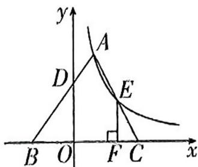

<!-- question-source:start -->
4 [2023 辽宁鞍山中考]如图, 在 $\triangle ABC$ 中, $BA = BC$ , 顶点 $C, B$ 分别在 $x$ 轴的正、负半轴上, 点 $A$ 在第一象限, 经过点 $A$ 的反比例函数 $y = \frac{k}{x} (x > 0)$ 的图象交 $AC$ 于点 $E$ , 过点 $E$ 作 $EF \perp x$ 轴, 垂足为点 $F$ , 若点 $E$ 为 $AC$ 的中点, $BD = 2AD$ , $BF - CF = 3$ , 则 $k$ 的值为 \_\_\_\_.

<!-- question-source:end -->

![[Q00108229A1]]
