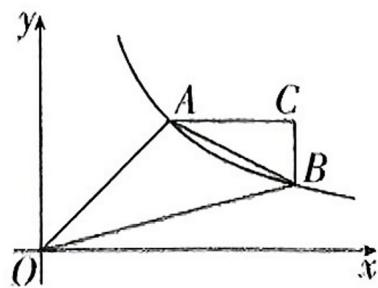

<!-- question-source:start -->
5[2023 浙江绍兴中考]如图,在平面直角坐标系 $xOy$ 中,函数 $y = \frac{k}{x}$ ( $k$ 为大于0

的常数, $x > 0$ )图象上的两点 $A(x_{1},y_{1}),B(x_{2}, y_{2})$ , 满足 $x_{2} = 2x_{1}$ , $\triangle ABC$ 的边 $AC / / x$ 轴, 边 $BC / /$

建议用时 35 分钟 答案 D84

y 轴, 若 $\triangle OAB$ 的面积为 6, 则 $\triangle ABC$ 的面积是 \_\_\_\_.
<!-- question-source:end -->

![[Q00108230A1]]
