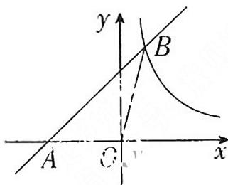

<!-- question-source:start -->
6[2024 湖北中考]如图,一次函数 $y=x+m$ 的图象与 x 轴交于点 A(-3,0),与反比例函数 $y=\frac{k}{x}$ (k 为常数, $k\neq0$ ) 的图象在第一象限的部分交于点 B(n,4).

(1) 求 m, n, k 的值;

(2) 若 C 是反比例函数 $y=\frac{k}{x}$ 的图象在第一象限部分上的点,且 $\triangle AOC$ 的面积小于 $\triangle AOB$ 的面积,直接写出点 C 的横坐标 a 的取值范围.

<!-- question-source:end -->

![[Q00108231A1]]
