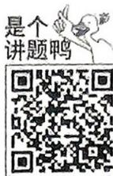

<!-- question-source:start -->
1 [2024 江苏淮安质检] 若点 $A(x_{1}, -6), B(x_{2}, -2), C(x_{3}, 2)$ 在反比例函数 $y = \frac{12}{x}$ 的图象上, 则 $x_{1}, x_{2}, x_{3}$ 的大小关系是
A. $x_{1}<x_{2}<x_{3}$ B. $x_{2}<x_{1}<x_{3}$ C. $x_{2}<x_{3}<x_{1}$ D. $x_{3}<x_{2}<x_{1}$

<!-- question-source:end -->

![[Q00108234A1]]
