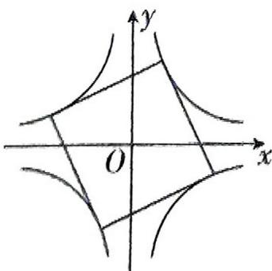
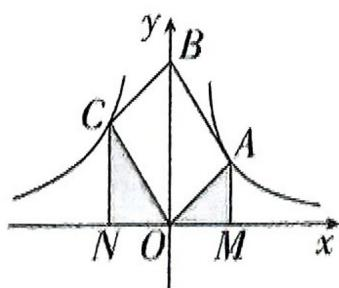

<!-- question-source:start -->
4[2023 福建中考]如图,正方形四个顶点分别位于两个反比例函数 $y=\frac{3}{x}$ 和 $y=\frac{n}{x}$ 的图象的四个分支上,则实数 n 的值为 ( )
A.-3 B. $-\frac{1}{3}$ C. $\frac{1}{3}$ D.3

(第4题图)

(第5题图)
<!-- question-source:end -->

![[Q00108237A1]]
