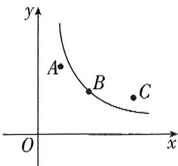
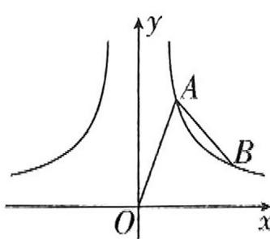

<!-- question-source:start -->
7 [2025 河北石家庄质检]劳动教育课上,徐老师带领九(1)班同学对甲、乙、丙三类小麦种子的发芽情况进行统计(种子培养环境相同).如图,用A,B,C三点分别表示甲、乙、丙三类种子的发芽率y与该类种子用于实验的数量x的情况,其中点B在反比例函数图象上,则三类种子中,发芽数量最多的是\_\_\_\_类种子.(填“甲”“乙”或“丙”)

(第7题图)
(第8题图)
<!-- question-source:end -->

![[Q00108240A1]]
