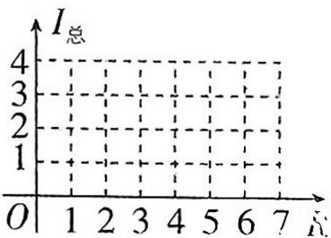

<!-- question-source:start -->
8[2024 江苏泰州海陵区期末]在平面直角坐标系中, 将一点的横坐标与纵坐标互换后得到的点叫这一点的“互换点”. 如图, 反比例函数 $y = \frac{12}{x} (x > 0)$ 与 $y = \frac{k}{x} (x < 0)$ 的图象关于 $y$ 轴对称, 点 $A, B$ 在函数 $y = \frac{12}{x} (x > 0)$ 的图象上 ( $A$ 在 $B$ 的左侧), 当 $A$ 是 $B$ 的“互换点”且 $AB = 4\sqrt{2}$ 时, 函数 $y = \frac{k}{x} (x < 0)$ 的图象上存在一点 $C$ , 使 $\triangle AOC$ 是直角三角形, 且 $\angle AOC = 90^\circ$ , 则点 $C$ 的坐标为 \_\_\_\_.

<!-- source-part:5 pages:101-103 -->

<table><tr><td colspan="2">探究并联电路中电阻R与电</td></tr><tr><td>背景材料</td><td>如图,在并联电路中,电源电压 $U_{总} = 6 \text{ V}$ ,根据“并联电路分流不分压”的原理得到 $I_{总} = I_1 + I_2 \left( I_1 = \frac{6}{R_1}, I_2 = \frac{6}{R} \right)$ .已知 $R_1$ 为定值电阻,当R变化时,干路电流 $I_{总}$ 也会发生变化,且干路电流 $I_{总}$ 与R之间满足如下关系: $I_{总} = 1 + \frac{6}{R}$ 问题解决</td></tr><tr><td>任务1</td><td>画出函数 $I_{总} = 1 + \frac{6}{R}$ 的图象</td></tr><tr><td>任务2</td><td>探究函数图象的平移规律</td></tr><tr><td>任务3</td><td>函数的应用</td></tr></table>

<table><tr><td>任务1</td><td>画出函数 $I_{\text{总}} = 1 + \frac{6}{R}$ 的图象</td><td></td></tr><tr><td>任务2</td><td>探究函数图象的平移规律</td><td>函数 $I_{\text{总}} = 1 + \frac{5}{R}$ 的图象是由 $I_2 = \frac{6}{R}$ 的图象向____平移____个单位得到的</td></tr><tr><td>任务3</td><td>函数的应用</td><td>若关于x的方程 $\left|1 + \frac{6}{x}\right| = kx + 6$ 在实数范围内恰好有两个解,直接写出k的值</td></tr></table>
<!-- question-source:end -->

![[Q00108241A1]]
