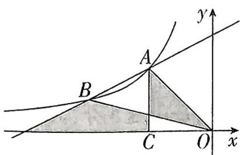
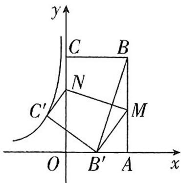

<!-- question-source:start -->
9 如图, 反比例函数 $y = -\frac{12}{x} (x < 0)$ 的图象与直线 $y = \frac{1}{2} x + b (b > 0)$ 交于 $A, B$ 两点 (点 $A$ 在点 $B$ 右侧), 过点 $A$ 作 $x$ 轴的垂线, 垂足为点 $C$ , 连接 $AO, BO$ , 图中阴影部分的面积为 12, 则 $b$ 的值为 \_\_\_\_.

(第9题图)

(第 10 题图)
<!-- question-source:end -->

![[Q00108242A1]]
