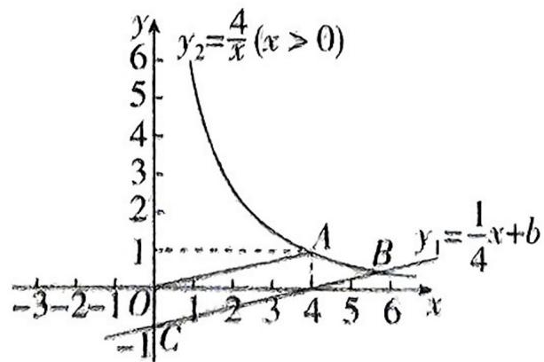

<!-- question-source:start -->
11 已知在平面直角坐标系中, 点 $A(4,1)$ , 若直线 $y_{1} = \frac{1}{4} x + b$ 与双曲线 $y_{2} = \frac{4}{x} (x > 0)$ 交于点 $B$ , 与 $y$ 轴交于点 $C$ . 探究: 由双曲线 $y_{2} = \frac{4}{x}$ ( $x > 0$ ) 与线段 $OA, OC, BC$ 围成的区域 $M$ 内 (不含边界) 整点的个数. (点的横、纵坐标都是整数的点称为整点)
(1) 当 $b = -1$ 时, 如图, 区域 $M$ 内的整点的个数为 \_\_\_\_;
(2) 若区域 $M$ 内恰好有 4 个整点, 求 $b$ 的取值范围.

<!-- question-source:end -->

![[Q00108244A1]]
