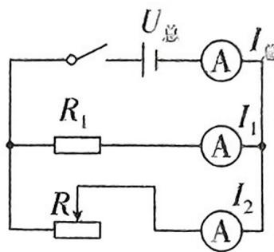

<!-- question-source:start -->
12 新考向跨学科综合 [2024 江西吉安期末] 根据背景材料, 探索解决问题:

教育部发布的《关于加强初中学业水平考试命题工作的意见》中指出:试题命制既要注重考查基础知识、基本技能,还要注重考查思维过程、创新意识和分析问题、解决问题的能力.结合不同学科特点,合理设置试题结构,减少机械记忆试题和客观性试题比例,提高探究性、开放性、综合性试题比例,积极探索跨学科命题.结合《义务教育数学课程标准(2022年版)》新变化,通过分析全国百余套中考试题,发现以传统文化为背景的试题,以及探究性、开放性、综合性、跨学科试题在中考试题中出现得越来越频繁,故精选部分试题,让学生感受考向变化.
<!-- question-source:end -->

![[Q00108245A1]]
