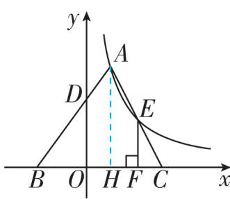
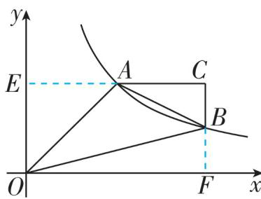

> [!success]- 必刷题
>
> > [!success] **【答案】** 4
>
> > [!note]- **【解析】**
> > 过点 A 作
> > AH ⊥ x 轴于 H, 如图.
> > ∵ EF ⊥ x 轴, ∴ EF∥AH.
> > 又∵ 点 E 为 AC 的中点,
> > ∴ 易知 EF 为 △AHC 的中
> >
> > 
> >
> > 位线, $\therefore AH = 2EF, CF = HF.\because BF - CF = 3,$ $\therefore BF - HF = 3$ ，即 $BH = 3.\because AH\perp x$ 轴， $\therefore AH / /$ $OD,\therefore BD:AD = OB:OH.\because BD = 2AD,\therefore OB =$ $2OH,\therefore BH = OB + OH = 3OH = 3,\therefore OH = 1,$ $\therefore OB = 2.$ 设 $CF = HF = a, EF = b$ ，则 $AH = 2EF=$ $2b,CH = 2a,\therefore$ 点 $A$ 的坐标为(1,2b)，点 $E$ 的坐标为 $(1 + a,b)$ .∵点 $A,E$ 在反比例函数 $y=$ $\frac{k}{x} (x > 0)$ 的图象上， $\therefore k = 1\times 2b = (1 + a)\times b$ ，解得 $a = 1,\therefore CH = 2a = 2,\therefore BA = BC = BH + CH=$ $3 + 2 = 5.$ 在Rt△ABH中， $BH = 3,BA = 5$ ，由勾股定理得 $AH = \sqrt{BA^2 - BH^2} = 4,\therefore$ 点 $A$ 的坐标为(1,4)， $\therefore k = 1\times 4 = 4.$ 故答案为4.
> >
> > 5.2 【解析】如图,延长 CA 交 y 轴于 E,延长
> >
> > CB 交 x 轴于点 F,
> > ∴ CE⊥y 轴, CF⊥x 轴,
> > ∴ 四边形 OECF 为矩形. ∵ $x_{2}=2x_{1}$ , ∴ 点 A 为 CE 中点. 由比例系
> >
> > 
> >
> > 数 $k$ 的几何意义得， $S_{\triangle OAE} = S_{\triangle OBF}$ ，∴ 点 $B$ 为 $CF$ 中点， $\therefore S_{\triangle OAB} = \frac{3}{8} S_{\text{矩形}OECF} = 6, \therefore S_{\text{矩形}OECF} = 16, \therefore S_{\triangle ABC} = \frac{1}{8} \times 16 = 2.$ 故答案为 2.
> >
> > ## 关键点拨
> >
> > 一次函数与反比例函数图象的交点情况，就是由一次函数与反比例函数表达式联立得到的一元二次方程的解的情况.
