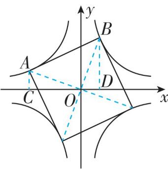

> [!success]- 必刷题
>
> > [!success] **【答案】** A
>
> > [!note]- **【解析】**
> > 连接正方形的对角线,由正方形和反比例函数图象均是中心对称图形可知对
> >
> > 角线交于原点 O, 过点 A, B 分别作 x 轴的垂线, 垂足分别为 C, D, 点 B 在函数 $y = \frac{3}{x}$ 的图象上, 如图. ∵ 正方形中, AO =
> >
> > 
> >
> > $BO, \angle AOB = \angle BDO = \angle ACO = 90^{\circ}, \therefore \angle CAO = 90^{\circ} - \angle AOC = \angle BOD, \therefore \triangle AOC \cong \triangle OBD$ (AAS), $\therefore S_{\triangle AOC}=S_{\triangle OBD}=\frac{3}{2}=\frac{|n|}{2},\therefore n=\pm3.$ ∵ 点 A 在第二象限，∴ n=-3，
> >
> > 故选 **A**.
