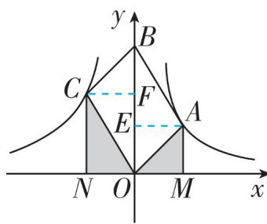

> [!success]- 必刷题
>
> > [!success] **【答案】** B
>
> > [!note]- **【解析】**
> > 作 $AE \perp y$ 轴于 $E$ , 作 $CF \perp y$ 轴于 $F$ , 如图. ∵ 四边形 $OABC$ 是平行四边形, ∴ $S_{\triangle AOB} = S_{\triangle COB}$ , ∴ $AE = CF$ , ∴ $OM =$
> >
> > 
> >
> > $ON.\because S_{\triangle AOM} = \frac{1}{2}\mid k_1\mid = \frac{1}{2} OM\cdot AM,S_{\triangle CON} =$ $\frac{1}{2}\mid k_2\mid = \frac{1}{2} ON\cdot CN,\therefore \frac{AM}{CN} = \left|\frac{k_1}{k_2}\right|$ ，故①正确. $\because S_{\triangle AOM} = \frac{1}{2}\mid k_1\mid ,S_{\triangle CON} = \frac{1}{2}\mid k_2\mid ,\therefore S_{\text{阴影部分}} =$ $S_{\triangle AOM} + S_{\triangle CON} = \frac{1}{2}\times (|k_1| + |k_2|).$ 由题意得 $k_{1}>$
> >
> > $0, k_{2} < 0, \therefore S_{\text{阴影部分}} = \frac{1}{2}(k_{1} - k_{2})$ ，故②错误。当 $\angle AOC = 90^{\circ}$ 时，四边形 $OABC$ 是矩形，不能确定 $OA$ 与 $OC$ 相等，而 $OM = ON, \therefore$ 不能判定 $\triangle AOM \cong \triangle CON, \therefore$ 不能确定 $AM = CN, \therefore$ 不能确定 $|k_{1}| = |k_{2}|$ ，故③错误。若四边形 $OABC$ 是菱形，则 $OA = OC$ 。又 $\because OM = ON, \therefore Rt\triangle AOM \cong Rt\triangle CON(HL), \therefore AM = CN, \therefore |k_{1}| = |k_{2}|, \therefore k_{1} = -k_{2}, \therefore k_{1} + k_{2} = 0$ ，故④正确。
