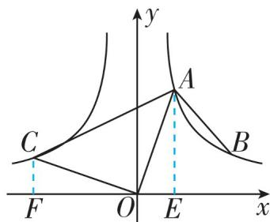

> [!success]- 必刷题
>
> > [!success] **【答案】** (-6,2)
>
> > [!note]- **【解析】**
> > ∵ 反比例函数 $y=\frac{12}{x}(x>0)$ 与 $y=\frac{k}{x}(x<0)$ 的图象关于 y 轴对称，∴ 易得 k=-12，即 $y=-\frac{12}{x}(x<0)$ . 设 $A\left(x,\frac{12}{x}\right)$ ，则 $B\left(\frac{12}{x},x\right)$ . ∵ $AB=4\sqrt{2}$ , ∴ $\left(x-\frac{12}{x}\right)^{2}+\left(\frac{12}{x}-x\right)^{2}=$ $(4\sqrt{2})^{2}$ ，解得 x=2 或 x=6（负数已舍去）. ∵ A
> >
> > ## 思路分析
> >
> > 在 B 的左侧, $\therefore A(2,6)$ , $B(6,2)$ . 如图, 作 $AE \perp x$ 轴于 E, 作 $CF \perp x$ 轴于 F, 则 OE = 2, AE = 6. 设 $C\left(y, -\frac{12}{y}\right)$ , 则 OF = -y,
> >
> > 
> >
> > 由两个反比例函数图象关于 $y$ 轴对称可求出 $k$ 值，设出点 $A$ 的坐标，从而表示出点 $B$ 的坐标，利用 $AB$ 的长和勾股定理列方程，然后解方程求得 $A, B$ 的坐标。作 $AE \perp x$ 轴于 $E$ ，作 $CF \perp x$ 轴于 $F$ ，通过证明 $\triangle OFC \sim \triangle AEO$ ，即可求得点 $C$ 的坐标。
> >
> > $CF = -\frac{12}{y}$ . ∵ $\triangle AOC$ 是直角三角形, $\angle AOC = 90^{\circ}$ , ∴ $\angle COF + \angle AOE = 90^{\circ}$ . ∵ $\angle AOE + \angle OAE = 90^{\circ}$ , ∴ $\angle COF = \angle OAE$ . ∵ $\angle OFC = \angle AEO = 90^{\circ}$ , ∴ $\triangle OFC \sim \triangle AEO$ , ∴ $\frac{OF}{AE} = \frac{CF}{OE}$ ,
> > 即 $\frac{-y}{6}=\frac{-\frac{12}{y}}{2}$ ，解得y=-6（正数已舍去），
> > ∴ C(-6,2). 故答案为(-6,2).
