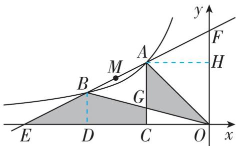

> [!success]- 必刷题
>
> > [!success] **【答案】** $3\sqrt{3}$
>
> > [!note]- **【解析】**
> > 设直线 $y = \frac{1}{2} x + b$ 与 $x$ 轴、 $y$ 轴分
> >
> > ## 刷有所得
> >
> > 在反比例函数中, 过反比例函数图象上一点向坐标轴作垂线段, 是常见的作辅助线的方法.
> >
> > 别交于点 E, F. 过 B 作 $BD \perp OE$ 于 D, 过 A 作 $AH \perp y$ 轴于 H, 设 AC 交 OB 于 G, 如图. 设
> >
> > 
> >
> > M 为 AB 的中点, $A(x_{1}, y_{1})$ , $B(x_{2}, y_{2})$ , 由 $\left\{\begin{aligned}y&=-\frac{12}{x},\\ &得 x^{2}+2bx+24=0, \therefore x_{1}+x_{2}=-2b,\\ y&=\frac{1}{2}x+b,\end{aligned}\right.$ $y_{1}+y_{2}=\left(\frac{1}{2}x_{1}+b\right)+\left(\frac{1}{2}x_{2}+b\right)=\frac{1}{2}(x_{1}+x_{2})+2b=$ $b,\therefore M\left(-b,\frac{b}{2}\right).$ ∵ 直线 $y=\frac{1}{2}x+b(b>0)$ 与 x 轴、y 轴分别交于点 E,F,∴ $E(-2b,0)$ , $F(0,b)$ , ∴ EF 的中点为 $\left(-b,\frac{b}{2}\right)$ ，即 EF 的中点也为 M. ∵ EM = FM, BM = AM, ∴ EB = FA.
> > ∵ AH⊥y 轴, ∴ AH∥OE, ∴ ∠FAH = ∠BED. 又
> > ∵ ∠AHF = ∠EDB, ∴ △EDB ≅ △AHF (AAS),
> > ∴ AH = ED = OC. ∵ $(S_{\triangle AGO} + S_{\triangle GCO}) + (S_{\triangle GCO} + S_{四边形GCDB}) = \frac{1}{2}|k| + \frac{1}{2}|k| = 12$ ，且图中阴影部分的面积为 12, ∴ $S_{\triangle BDE} = 2S_{\triangle GCO}$ , ∴ $\frac{1}{2}ED \cdot BD = 2 \times \frac{1}{2}OC \cdot GC$ , ∴ BD = 2GC, ∴ OD = 2OC,
> > 即 $x_{2}=2x_{1}$ . 设 $x_{1}=m$ , 则 $x_{2}=2m$ ,
> > ∴ $A(m,-\frac{12}{m})$ , $B(2m,-\frac{6}{m})$ . 将 $A(m,-\frac{12}{m})$ , $B(2m,-\frac{6}{m})$ 代入 $y=\frac{1}{2}x+b$ 得 $\left\{\begin{aligned}-\frac{12}{m}&=\frac{1}{2}m+b,\\-\frac{6}{m}&=m+b,\end{aligned}\right.$ 解得 $m=2\sqrt{3}$ （舍去）或 $m=-2\sqrt{3}$ , ∴ b = $-\frac{12}{-2\sqrt{3}}-\frac{1}{2}\times(-2\sqrt{3})=3\sqrt{3}$ . 故答案为 $3\sqrt{3}$ .
