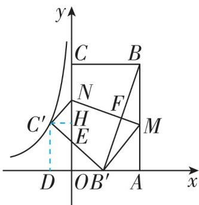

> [!success]- 必刷题
>
> > [!success] **【答案】** $-\frac{160\sqrt{2}}{81}$
>
> > [!note]- **【解析】**
> > 设 $B^{\prime}C^{\prime}$ 交 $y$ 轴于点 $E, MN$
> >
> > 交 $BB'$ 于点 $F$ , 过点 $C'$ 作 $C'D \perp x$ 轴于 $D, C'H \perp y$ 轴于点 $H$ , 如图所示. 易得四边形 $ODC'H$ 为矩形, $\therefore OD = C'H, \angle ODC' = 90^\circ$ . $\because$ 四边形 $OABC$ 是
> >
> > 
> >
> > 矩形, $\therefore \angle B'AM = \angle ABC = 90^\circ$ . 根据折叠的性质得 $CN = C'N, BM = B'M, B'C' = BC, \angle MB'C' = \angle ABC = 90^\circ$ . ∵ 点 $A(4,0), C(0,4\sqrt{2})$ 是矩形 $OABC$ 的顶点，∴ $BC = OA = B'C' = 4, OC = AB = 4\sqrt{2}$ . 设 $BM = B'M = t$ ，则 $AM = AB - BM = 4\sqrt{2} - t$ . ∵ 点 $B'$ 是 $OA$ 的中点，∴ $OB' = AB' = 2$ . 在 $\triangle AB'M$ 中，由勾股定理得 $AM^2 + AB'^2 = B'M^2$ ，即 $(4\sqrt{2} - t)^2 + 2^2 = t^2$ ，解得 $t = \frac{9\sqrt{2}}{4}, \therefore BM = B'M = \frac{9\sqrt{2}}{4}, AM = 4\sqrt{2} - t = \frac{7\sqrt{2}}{4}$ . ∵ $\angle MB'C' = 90^\circ, \angle B'AM = 90^\circ, \therefore \angle DB'C' + \angle AB'M = 90^\circ, \angle AMB' + \angle AB'M = 90^\circ, \therefore \angle DB'C' = \angle AMB'$ . 又∵ $\angle B'DC' = \angle B'AM = 90^\circ, \therefore \triangle B'C'D \sim \triangle MB'A, \therefore C'D : AB' = B'D : AM = B'C' : MB'$ ，即 $C'D: 2 = B'D: \frac{7\sqrt{2}}{4} = 4: \frac{9\sqrt{2}}{4}, \therefore C'D = \frac{16\sqrt{2}}{9}, B'D = \frac{28}{9}, \therefore OD = B'D - OB' = \frac{28}{9} - 2 = \frac{10}{9}, \therefore$ 点 $C'$ 的坐标为 $\left(-\frac{10}{9}, \frac{16\sqrt{2}}{9}\right)$ . ∵ 点 $C'$ 在反比例函数 $y = \frac{k}{x}$ 的图象上，∴ $k = -\frac{10}{9} \times \frac{16\sqrt{2}}{9} = -\frac{160\sqrt{2}}{81}$ . 故答案为 $-\frac{160\sqrt{2}}{81}$ .
