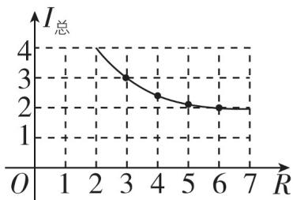

> [!success]- 必刷题
>
> > [!success] **【答案】** C
>
> > [!note]- **【解析】**
> > 【解】【任务 1】①列表：
> >
> > <table><tr><td>R</td><td>...</td><td>3</td><td>4</td><td>5</td><td>6</td><td>...</td></tr><tr><td> $I_{\text{总}} = 1 + \frac{6}{R}$ </td><td>...</td><td>3</td><td>2.5</td><td>2.2</td><td>2</td><td>...</td></tr></table>
> > - **②**：先描出点(3,3),(4,2.5),(5,2.2),(6,2),再用平滑的曲线顺次连接这些点即可画出所求函数图象,如图所示:
> >
> > 
> >
> > 【任务2】当 $R = 6$ 时, $I_{2} = 1$ , $I_{\text{总}} = 2$ ; 当 $R = 3$ 时, $I_{2} = 2$ , $I_{\text{总}} = 3$ ; 当 $R = 2$ 时, $I_{2} = 3$ , $I_{\text{总}} = 4$ . 结合图象, 可知函数 $I_{\text{总}} = 1 + \frac{6}{R}$ 的图象是由 $I_{2} = \frac{6}{R}$ 的图象向上平移 1 个单位得到的, 故答案为上, 1.
> >
> > 【任务3】 $k = 0$ 或 $\frac{49}{24}$ 或 $-\frac{25}{24}$ . 由函数与方程的关系可知, 当 $k < 0$ 时, $y = \left|1 + \frac{6}{x}\right|$ 与 $y = kx + 6$ 的图象在第一象限恰有一个交点时满足恰有两个实数解. 令 $1 + \frac{6}{x} = kx + 6$ , 化简得 $kx^{2} + 5x - 6 = 0$ , 则 $25 + 24k = 0$ , $\therefore k = -\frac{25}{24}$ . 当 $k > 0$ 时, $y = \left|1 + \frac{6}{x}\right|$ 与 $y = kx + 6$ 的图象在第二象限恰有一个交点时满足恰有两个实数解. 令 $-1 - \frac{6}{x} = kx + 6$ , 化简得 $kx^{2} + 7x + 6 = 0$ , 则 $49 - 24k = 0$ , $\therefore k = \frac{49}{24}$ . 当 $k = 0$ 时, $y = \left|1 + \frac{6}{x}\right|$ 与 $y = kx + 6$ 的图象恰好有两个交点, 即 $\left|1 + \frac{6}{x}\right| = kx + 6$ 在实数范围内恰好有两个解. 综上, $k = 0$ 或 $\frac{49}{24}$ 或 $-\frac{25}{24}$ .
> >
> > 刷考向 1. C 【解析】左视图为----. 故选 C.
> >
> > ## 中考新考向备训
> >
> > 2. C 【解析】已知长为 $x$ 步, 则宽为 $(60 - x)$ 步, $\therefore x(60 - x) = 864$ , 故选 C.
> >
> > 性质得 $CN = C'N, BM = B'M, B'C' = BC, \angle MB'C' = \angle ABC = 90^\circ$ . ∵ 点 $A(4,0), C(0,4\sqrt{2})$ 是矩形 $OABC$ 的顶点，∴ $BC = OA = B'C' = 4, OC = AB = 4\sqrt{2}$ . 设 $BM = B'M = t$ ，则 $AM = AB - BM = 4\sqrt{2} - t$ . ∵ 点 $B'$ 是 $OA$ 的中点，∴ $OB' = AB' = 2$ . 在 $\triangle AB'M$ 中，由勾股定理得 $AM^2 + AB'^2 = B'M^2$ ，即 $(4\sqrt{2} - t)^2 + 2^2 = t^2$ ，解得 $t = \frac{9\sqrt{2}}{4}, \therefore BM = B'M = \frac{9\sqrt{2}}{4}, AM = 4\sqrt{2} - t = \frac{7\sqrt{2}}{4}$ . ∵ $\angle MB'C' = 90^\circ, \angle B'AM = 90^\circ, \therefore \angle DB'C' + \angle AB'M = 90^\circ, \angle AMB' + \angle AB'M = 90^\circ, \therefore \angle DB'C' = \angle AMB'$ . 又∵ $\angle B'DC' = \angle B'AM = 90^\circ, \therefore \triangle B'C'D \sim \triangle MB'A, \therefore C'D : AB' = B'D : AM = B'C' : MB'$ ，即 $C'D: 2 = B'D: \frac{7\sqrt{2}}{4} = 4: \frac{9\sqrt{2}}{4}, \therefore C'D = \frac{16\sqrt{2}}{9}, B'D = \frac{28}{9}, \therefore OD = B'D - OB' = \frac{28}{9} - 2 = \frac{10}{9}, \therefore$ 点 $C'$ 的坐标为 $(- \frac{10}{9}, \frac{16\sqrt{2}}{9})$ . ∵ 点 $C'$ 在反比例函数 $y = \frac{k}{x}$ 的图象上，∴ $k = -\frac{10}{9} \times \frac{16\sqrt{2}}{9} = -\frac{160\sqrt{2}}{81}$ . 故答案为 $-\frac{160\sqrt{2}}{81}$ .
> >
> > 11.【解】(1)∵A(4,1)，∴直线OA的函数表达式为 $y=\frac{1}{4}x$ . ∵直线 $y_{1}=\frac{1}{4}x+b$ , ∴直线 $y_{1}$ 与OA平行. 当b=-1时，直线表达式为 $y_{1}=\frac{1}{4}x-1$ ，解方程 $\frac{4}{x}=\frac{1}{4}x-1$ ，得 $x_{1}=2-2\sqrt{5}$ （舍去）， $x_{2}=2+2\sqrt{5}$ ，则 $B(2+2\sqrt{5},\frac{\sqrt{5}-1}{2})$ . 又∵ $C(0,-1)$ ，∴区域M内的整点有(1,0)，(2,0)，(3,0)，共3个. 故答案为3.
> > (2) 直线 $y_{1}$ 在 OA 的下方时，当直线 $y_{1}=\frac{1}{4}x+b$ 过 (1,-1) 时， $b=-\frac{5}{4}$ ，且经过 (5,0)，∴区域 M 内恰有 4 个整点时，b 的取值范围是 $-\frac{5}{4}\leqslant b<-1$ . 直线 $y_{1}$ 在 OA 的上方时，∵点 (2,2) 在函数 $y_{2}=\frac{4}{x}(x>0)$ 的图象上，当直线 $y_{1}=\frac{1}{4}x+b$ 过 (1,2) 时， $b=\frac{7}{4}$ ;
> >
> > 当直线 $y_{1}=\frac{1}{4}x+b$ 过(1,3)时, $b=\frac{11}{4}$ ,∴ 区域 M 内恰有 4 个整点时,b 的取值范围是 $\frac{7}{4}<b\leqslant\frac{11}{4}$ .
> > 综上所述,区域M内恰有4个整点时,b的取值范围是 $-\frac{5}{4}\leqslant b<-1$ 或 $\frac{7}{4}<b\leqslant\frac{11}{4}$ .
> >
> > 12.【解】【任务 1】①列表：
> >
> > <table><tr><td>R</td><td>...</td><td>3</td><td>4</td><td>5</td><td>6</td><td>...</td></tr><tr><td> $I_{\text{总}} = 1 + \frac{6}{R}$ </td><td>...</td><td>3</td><td>2.5</td><td>2.2</td><td>2</td><td>...</td></tr></table>
> > - **②**：先描出点(3,3),(4,2.5),(5,2.2),(6,2),再用平滑的曲线顺次连接这些点即可画出所求函数图象,如图所示:
> >
> > 
> >
> > 【任务2】当 $R = 6$ 时, $I_{2} = 1$ , $I_{\text{总}} = 2$ ; 当 $R = 3$ 时, $I_{2} = 2$ , $I_{\text{总}} = 3$ ; 当 $R = 2$ 时, $I_{2} = 3$ , $I_{\text{总}} = 4$ . 结合图象, 可知函数 $I_{\text{总}} = 1 + \frac{6}{R}$ 的图象是由 $I_{2} = \frac{6}{R}$ 的图象向上平移 1 个单位得到的, 故答案为上, 1.
