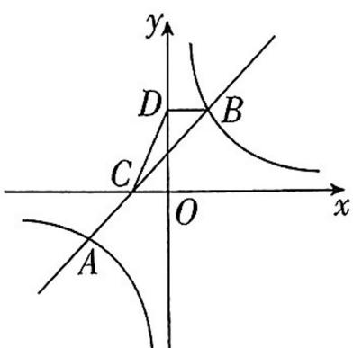
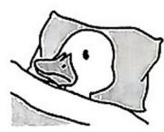
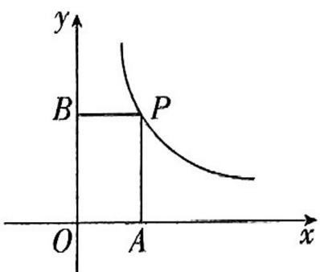
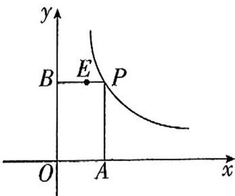

<!-- question-source:start -->
1 母题学大招 14 一点一垂线

[中]如图, 直线 AB 交 x 轴于点 C, 交反比例函数 $y = \frac{a - 1}{x} (a > 1)$ 的图象于 A, B 两点, 过点 B 作 $BD \perp y$ 轴, 垂足为点 D, 若 $S_{\triangle BCD} = 5$ , 则 a 的值为 ( )

想刷题 想得睡不着

A. 8 B. 9 C. 10 D. 11

母题学大招 15 资料更新, 关注公众号★全科AA+2[较难]如图(1), P 是反比例函数 $y=\frac{12}{x}(x>0)$ 图象上的一个动点, 过 P 作 $PA \perp x$ 轴, $PB \perp y$ 轴, 垂足分别为 A, B.

(1) 若矩形的对角线 AB=10, 则矩形 OAPB 的周长为 \_\_\_\_;
(2) 如图(2), 点 E 在 BP 上, 且 BE=2PE, 若 E 关于直线 AB 的对称点 F 恰好落在坐标轴上, 连接 AE, AF, EF, 求 $\triangle AEF$ 的面积.

图(1)

图(2)

建议限时 50 分钟 答案 D31
<!-- question-source:end -->

![[Q00108215A1]]
