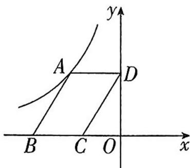

<!-- question-source:start -->
3[2025 宁夏银川期末, 中]如图, 点 $A$ 是反比例函数 $y = -\frac{k}{x} (x < 0)$ 的图象上的一点, 以 $A$ 为顶点作 $\square ABCD$ , 使点 $B, C$ 在 $x$ 轴上, 点 $D$ 在 $y$ 轴上, 若 $\square ABCD$ 的面积为 6 , 则 $k$ 的值是 ( )

A. 1 B. 3 C. 6 D. -6
<!-- question-source:end -->

![[Q00108216A1]]
