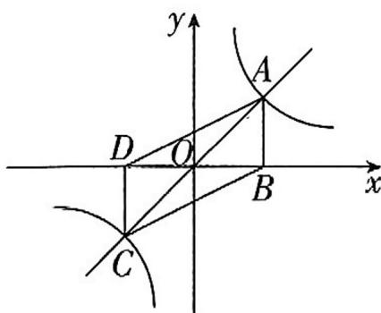

<!-- question-source:start -->
4[中]正比例函数 y=x 与反比例函数 $y=\frac{1}{x}$ 的图象相交于 A, C 两点. 过 A 作 $AB \perp x$ 轴于 B, 过 C 作 $CD \perp x$ 轴于 D, 连接 AD, BC, 如图, 则四边形 ABCD 的面积为 ( )

A. 1 B. $\frac{3}{2}$ C. 2 D. $\frac{5}{2}$
<!-- question-source:end -->

![[Q00108217A1]]
