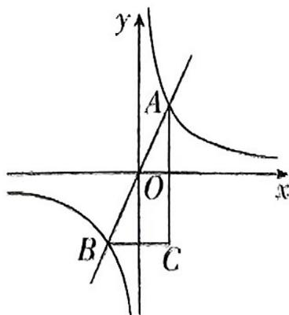

<!-- question-source:start -->
5[2025 重庆渝中区校级质检, 中]如图, 直线 $AB$ 过原点 $O$ , 与反比例函数 $y = \frac{k}{x}$ 的图象交于 $A, B$ 两点, $AC // y$ 轴, $BC // x$ 轴, 若 $\triangle ABC$ 的面积为 2 , 则 $k$ 的值为 \_\_\_\_.

母题学大招 17 两曲一平行
<!-- question-source:end -->

![[Q00108218A1]]
