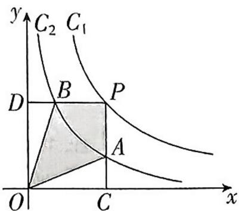

<!-- question-source:start -->
6[中]两个反比例函数 $C_1: y = \frac{2}{x}$ 和 $C_2: y = \frac{1}{x}$ 在第一象限内的图象如图所示, 设点 $P$ 在 $C_1$ 上, $PC \perp x$ 轴于点 $C$ , 交 $C_2$ 于点 $A, PD \perp y$ 轴于点 $D$ , 交 $C_2$ 于点 $B$ , 则四边形 $PAOB$ 的面积为 ( )

A. 1 B. 2 C. 3 D. 4
<!-- question-source:end -->

![[Q00108219A1]]
