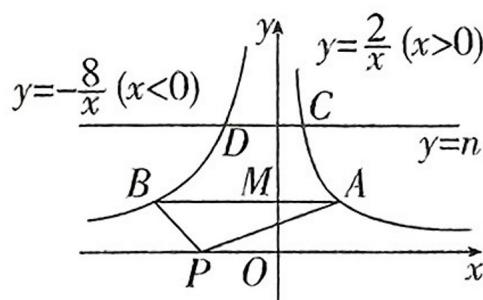

<!-- question-source:start -->
7 [2024 安徽安庆调研, 中] 已知反比例函数 $y = \frac{2}{x} (x > 0)$ 和反比例函数 $y = -\frac{8}{x} (x < 0)$ 的图象如图所示. (1) 点 $A$ 在反比例函数 $y = \frac{2}{x} (x > 0)$ 的图象上,过点 A 作 y 轴的垂线交反比例函数 $y = -\frac{8}{x} (x < 0)$ 的图象于点 B，交 y 轴于点 M，点 P 在 x 轴上，连接 PA, PB，求 $\triangle PAB$ 的面积；

(2) 直线 $y = n (n > 0)$ 交反比例函数 $y = \frac{2}{x} (x > 0)$ 的图象于点 $C$ , 交反比例函数 $y = -\frac{8}{x} (x < 0)$ 的图象于点 $D$ , 若 $CD = 4$ , 求 $n$ 的值.

<!-- question-source:end -->

![[Q00108220A1]]
