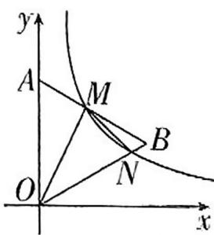
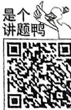

<!-- question-source:start -->
2 “三角形”化“梯形”法 [2024江西南昌调研,中] 如图,等边 $\triangle OAB$ 的边长为8,点A在y轴上,点B在第一象限,反比例函数 $y=\frac{k}{x}(x>0)$ 的图象经过AB的中点M,与OB相交于点N.

(1) 求 $k$ 的值;

(2) 连接 OM, MN, 求 $\triangle OMN$ 的面积.

电子错题本鸭
<!-- question-source:end -->

![[Q00108221A1]]
