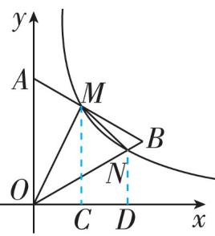

> [!success]- 必刷题
>
> > [!success] **【答案】** D
>
> > [!note]- **【解析】**
> > 设 $A\left(m,\frac{k}{m}\right)$ ，则 $B\left(-\frac{2m}{k},\frac{k}{m}\right)$ ， $D\left(m,-\frac{2}{m}\right),\therefore C\left(-\frac{2m}{k},-\frac{2}{m}\right),\therefore S_{2}=S_{4}=2,$ $S_{3}=\frac{4}{k}.\because S_{2}+S_{3}+S_{4}=\frac{11}{2},\therefore 2+\frac{4}{k}+2=\frac{11}{2}$ ，解得 $k=\frac{8}{3}$ ，经检验， $k=\frac{8}{3}$ 是方程的解，符合题意.
> > 故选 D.
> >
> > <table><tr><td>作AC⊥x轴,BD⊥x轴</td><td>结论:1 $S_{\triangle AOC}$ = $S_{\triangle BOD}=\frac{|k|}{2}$ ;2 $S_{\triangle AOE}=S_{四边形ECDB}$ ;3 $S_{\triangle AOB}=S_{梯形ACDB}$ </td></tr></table>
> >
> > 【解】(1)∵等边△OAB的边长为8,点A在y轴上,点B在第一象限,∴A(0,8),B(8× $\frac{\sqrt{3}}{2}$ , 8× $\frac{1}{2}$ ),即B(4 $\sqrt{3}$ ,4).∵M是AB的中点, ∴M(2 $\sqrt{3}$ ,6).∵反比例函数y= $\frac{k}{x}$ (x>0)的图象经过AB的中点M,∴k=2 $\sqrt{3}$ ×6=12 $\sqrt{3}$ .
> >
> > (2)如图,作 $MC \perp x$ 轴于 C, $ND \perp x$ 轴于 D, 则
> >
> > 
> >
> > $S_{\triangle MOC}=S_{\triangle NOD}=\frac{1}{2}k.\because B(4\sqrt{3},$ 4), ∴ 直线 OB 的表达式为 $y=\frac{\sqrt{3}}{3}x.$ 联立 $\left\{\begin{aligned}y&=\frac{\sqrt{3}}{3}x,\\ y&=\frac{12\sqrt{3}}{x},\end{aligned}\right.$ 解得 $\left\{\begin{aligned}x=6,\\ y=2\sqrt{3}\end{aligned}\right.$ 或 $\left\{\begin{aligned}x&=-6,\\ y&=-2\sqrt{3},\end{aligned}\right.$ $\therefore N(6,2\sqrt{3}),$ $\therefore S_{\triangle OMN}=S_{\triangle OMC}+S_{梯形MCDN}-S_{\triangle OND}=S_{梯形MCDN}=$ $\frac{1}{2}(6+2\sqrt{3})(6-2\sqrt{3})=12.$
> >
> > 关键点拨
> > (2) 画出图象, 联立方程组求出两函数图象交点坐标, 利用数形结合的思想求解是解题的关键.
