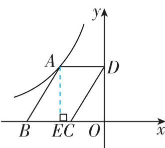
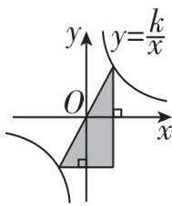
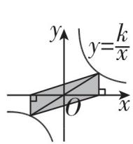
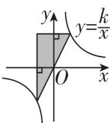
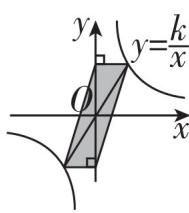

> [!success]- 必刷题
>
> > [!success] **【答案】** C
>
> > [!note]- **【解析】**
> > 作 $AE \perp BC$ 于 $E$ , 如图. ∵ 四边形 $ABCD$ 为平行四边形, ∴ $AD \parallel x$ 轴, ∴ 易知四边形 $ADOE$ 为矩形, ∴ $S_{\text{平行四边形}ABCD} =$
> >
> > 
> >
> > $S_{矩形ADOE}=6.$ ∵ $S_{矩形ADOE}=|-k|, \therefore |-k|=6.$ ∵ 反比例函数的图象在第二象限，∴ -k < 0，即 k > 0, ∴ k = 6. 故选 C.
> >
> > 大招解读 | 两点两垂线
> > 模型特征: 已知反比例函数与正比例函数图象的交点, 由交点向 x 轴或 y 轴作两条垂线, 如图, $S_{阴影} = 2|k|$ .
> >
> > 
> >
> > 
> >
> > 
> >
> > 
