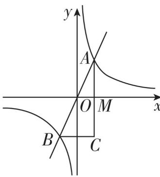
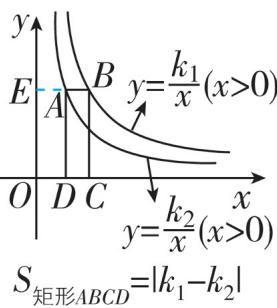
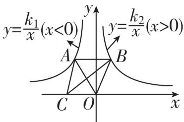
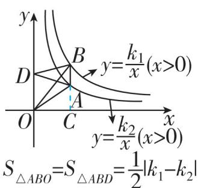
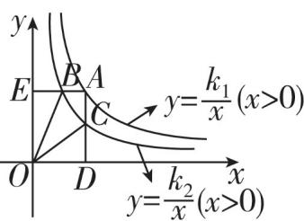

> [!success]- 必刷题
>
> > [!success] **【答案】** C
>
> > [!note]- **【解析】**
> > ∵ $AB \perp x$ 轴, $CD \perp x$ 轴, ∴ $S_{\triangle AOB} = S_{\triangle COD} = \frac{1}{2} |k| = \frac{1}{2}$ . 根据反比例函数图象的对称性可知 OB = OD, AB = CD, ∴ $S_{\triangle AOB} = S_{\triangle AOD}$ , $S_{\triangle COD} = S_{\triangle COB}$ , ∴ 四边形 ABCD 的面积为 $S_{\triangle AOB} + S_{\triangle ODA} + S_{\triangle ODC} + S_{\triangle OBC} = \frac{1}{2} \times 4 = 2$ . 故选 C.
> >
> > 5.1 【解析】设 $AC$ 与 $x$ 轴交于点 $M$ , 如图所示. $\because$ 直线 $AB$ 过原点 $O$ , 与反比例函数 $y = \frac{k}{x}$ 的图象交于 $A, B$ 两点, $AC \parallel y$ 轴,
> >
> > 
> >
> > $BC \parallel x$ 轴, $\therefore OA = OB$ , 易得 $\triangle AOM \sim \triangle ABC$ , $\therefore \frac{S_{\triangle AOM}}{S_{\triangle ABC}} = \left(\frac{OA}{AB}\right)^2 = \left(\frac{1}{2}\right)^2 = \frac{1}{4}$ . $\because \triangle ABC$ 的面积为 2, $\therefore S_{\triangle AOM} = \frac{1}{2}, \therefore |k| = 2S_{\triangle AOM} = 1.$ $\because$ 反比例函数图象分别位于第一、三象限, $\therefore k = 1$ . 故答案为 1.
> >
> > 大招解读 | 两曲一平行
> > 模型特征: 两条反比例函数图象上的两点连线平行于一条坐标轴, 求这两点与原点或坐标轴上的点构成的图形面积.
> > 模型图示
> >
> > 模型图示:
> >
> > 
> >
> > 
> >
> > 
> >
> > $$
> > S _ {\triangle A B O} = S _ {\triangle A B C} = \frac {1}{2} (| k _ {1} | + | k _ {2} |)
> > $$
> >
> > 
> > - **①**：$S_{\triangle BEO}=S_{\triangle CDO}=\frac{k_{2}}{2}$ ② $S_{四边形ABOC}=|k_{1}|-|k_{2}|$ 思路分析
> > 首先根据反比例函数中 k 的几何意义, 得出 $S_{\triangle AOB} = S_{\triangle ODC} = \frac{|k|}{2} = \frac{1}{2}$ , 再根据反比例函数图象的对称性得出 $S_{\triangle AOB} = S_{\triangle AOD}$ , $S_{\triangle COD} = S_{\triangle COB}$ , 即可求得答案.
> >
> > 思路分析
> > (1) 根据等边三角形的性质即可求得 A, B 的坐标, 进一步求得 M 的坐标, 代入 $y = \frac{k}{x}$ 即可求得 k 的值;
> > (2) 作 $MC \perp x$ 轴于 C, $ND \perp x$ 轴于 D, 则 $S_{\triangle MOC} = S_{\triangle NOD} = \frac{1}{2} k$ ,
> > 求出直线 OB 的表达式, 然后求得 N 的坐标, 进而根据 $S_{\triangle OMN} = S_{梯形MCDN}$ 即可求得答案.
