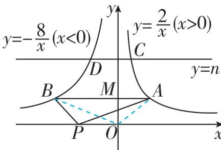

> [!success]- 必刷题
>
> > [!success] **【答案】** 详见解析
>
> > [!note]- **【解析】**
> > 【解】(1)如图,连接
> > OA, OB. $\because AB \perp y$ 轴， $\therefore S_{\triangle OAM}=1$ , $S_{\triangle OBM}=4,\therefore S_{\triangle OAB}=$ $S_{\triangle OAM} + S_{\triangle OBM} = 1 + 4 =$
> >
> > 
