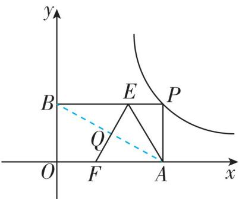
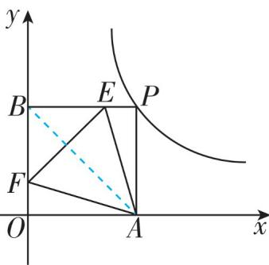

> [!success]- 必刷题
>
> > [!success] **【答案】** (1) $4 \sqrt{31}$
>
> > [!note]- **【解析】**
> > 设 $OA = m, OB = n$ , $\therefore P(m, n) \because P$ 在函数 $y = \frac{12}{x} (x > 0)$ 的图象
> >
> > ## 关键点拨
> >
> > 本题考查反比例函数与一次函数图象的综合,理解并掌握“一点一垂线”的模型特征是解题关键.
> >
> > ## 易错警示
> >
> > (2) 点 E 的对称点的位置不确定, 所以分两种情况: ① E 关于直线 AB 的对称点 F 恰好落在 x 轴上;
> > - **②**：E 关于直线 AB 的对称点 F 恰好落在 y 轴上.
> >
> > ## 关键点拨
> >
> > (1) 考查反比例函数图象的性质、勾股定理及完全平方公式, 读懂题意, 灵活运用
> >
> > 所学知识是解题关键.
> >
> > 上， $\therefore mn = 12$ 。\$\because\$ 矩形的对角线 $AB = 10$ ， $\therefore m^2 + n^2 = 10^2$ ，即 $(m + n)^2 - 2mn = 100$ ， $\therefore (m + n)^2 = 100 + 2 \times 12$ ，则 $m + n = 2\sqrt{31}$ （负值已舍去），\$\therefore\$ 矩形 $OAPB$ 的周长为 $4\sqrt{31}$ 。
> >
> > (2)【解】当 E 关于直线 AB 的对称点 F 恰好落在 x 轴上时, 如图(1), 连接 AB, 设 AB 与 EF 相交于点 Q. 由(1)知矩形 OAPB 的面积为 12, 而 BE = 2PE, ∴ $S_{\triangle ABE} = 4$ . ∵ 点 E 与点 F 关于直线 AB 对称, ∴ AB 垂直平分 EF, EQ = FQ, ∴ AE = AF, ∴ ∠AEF = ∠AFE. ∵ PB // OA, ∴ ∠AFE = ∠BEF, ∴ ∠BEF = ∠AEF, 易证 FQ 垂直平分 AB, ∴ BQ = AQ, ∴ $S_{\triangle AQE} = \frac{1}{2}S_{\triangle ABE} = 2$ , ∴ $S_{\triangle AEF} = 2S_{\triangle AQE} = 4$ .
> >
> > 
> > 图(1)
> >
> > 
> > 图(2)
> >
> > 当 $E$ 关于直线 $AB$ 的对称点 $F$ 恰好落在 $y$ 轴上时, 连接 $AB$ , 如图(2). $\because$ 点 $E$ 与点 $F$ 关于 $AB$ 对称, $\therefore BE = BF, AB \perp EF, \therefore \triangle BEF$ 为等腰直角三角形, $\therefore \angle OBA = \angle PBA$ . $\because PB \parallel OA, \therefore \angle PBA = \angle OAB, \therefore \angle OBA = \angle OAB, \therefore OB = OA, \therefore$ 四边形 $OAPB$ 为正方形, 易得 $P(2\sqrt{3}, 2\sqrt{3}), \therefore BE = BF = \frac{4\sqrt{3}}{3}$ , $\therefore PE = OF = \frac{2\sqrt{3}}{3}, \therefore S_{\triangle BEF} = \frac{1}{2} \times \frac{4\sqrt{3}}{3} \times \frac{4\sqrt{3}}{3} = \frac{8}{3}, S_{\triangle AOF} = S_{\triangle APE} = \frac{1}{2} \times \frac{2\sqrt{3}}{3} \times 2\sqrt{3} = 2,$ $\therefore S_{\triangle AEF} = 12 - \frac{8}{3} - 2 - 2 = \frac{16}{3}$ .
> >
> > 综上所述, $\triangle AEF$ 的面积为 4 或 $\frac{16}{3}$ .
