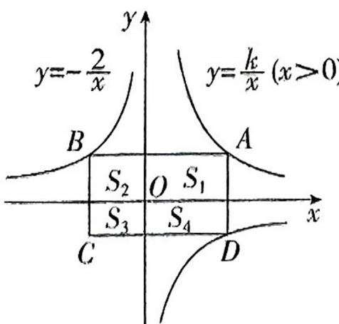

## 大招专题 4 反比例函数中 k 的几何意义

![[初中/课堂同步/教辅/必刷题/2026《初中必刷题》数学北师9上/06_第六章_反比例函数/大招专题_4_反比例函数中_k_的几何意义/questions/Q00108215.md]]

## © 子题练变式

![[初中/课堂同步/教辅/必刷题/2026《初中必刷题》数学北师9上/06_第六章_反比例函数/大招专题_4_反比例函数中_k_的几何意义/questions/Q00108216.md]]

## 母题学大招 16 两点两垂线

![[初中/课堂同步/教辅/必刷题/2026《初中必刷题》数学北师9上/06_第六章_反比例函数/大招专题_4_反比例函数中_k_的几何意义/questions/Q00108217.md]]

## © 子题练变式

![[初中/课堂同步/教辅/必刷题/2026《初中必刷题》数学北师9上/06_第六章_反比例函数/大招专题_4_反比例函数中_k_的几何意义/questions/Q00108218.md]]
![[初中/课堂同步/教辅/必刷题/2026《初中必刷题》数学北师9上/06_第六章_反比例函数/大招专题_4_反比例函数中_k_的几何意义/questions/Q00108219.md]]

## © 子题练变式

![[初中/课堂同步/教辅/必刷题/2026《初中必刷题》数学北师9上/06_第六章_反比例函数/大招专题_4_反比例函数中_k_的几何意义/questions/Q00108220.md]]

## 微专题6 反比例函数中与面积相关的解题方法

坐标法 [2025 浙江杭州期末, 中] 如图, 点 A 是反比例函数 $y = \frac{k}{x} (k \neq 0, x > 0)$ 的图象上一点, 过点 A 分别作 x 轴, y 轴的平行线交反比例函数 $y = -\frac{2}{x}$ 的图象于 B, D 两点, 以 AB, AD 为邻边作矩形 ABCD, 矩形 ABCD 被坐标轴分割成四个小矩形, 面积分别记为 $S_{1}, S_{2}, S_{3}, S_{4}$ , 若 $S_{2} + S_{3} + S_{4} = \frac{11}{2}$ , 则 k 的值为 ( )

A. $\frac{5}{2}$ B. $\frac{5}{3}$ C. 4 D. $\frac{8}{3}$

![[初中/课堂同步/教辅/必刷题/2026《初中必刷题》数学北师9上/06_第六章_反比例函数/大招专题_4_反比例函数中_k_的几何意义/questions/Q00108221.md]]
