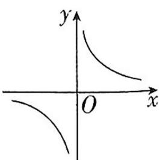

<!-- question-source:start -->
1 [2025云南昆明调研]已知 $y$ 关于 $x$ 的函数的图象如图所示, 其函数表达式可能是 ( )
A. $y = 2x^{2}$ B. $y = \frac{6}{x}$ C. $y = -\frac{3}{x}$ D. $y = 3x$

<!-- question-source:end -->

![[Q00108184A1]]
