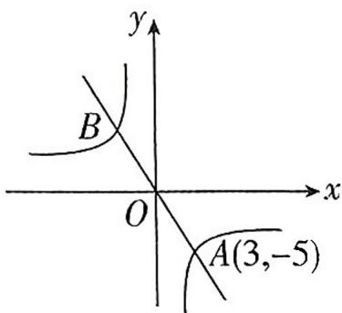
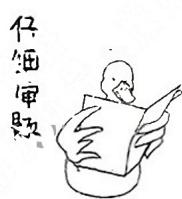

<!-- question-source:start -->
7 如图, 过原点的一条直线与反比例函数 $y = \frac{k}{x}$ $(k \neq 0)$ 的图象分别交于 A, B 两点, 若 A 点的坐标为 $(3, -5)$ , 则 B 点的坐标为 ( )

A. $(3, -5)$ B. $(-5, 3)$ C. $(-3, 5)$ D. $(-3, -5)$
<!-- question-source:end -->

![[Q00108189A1]]
