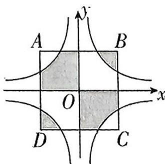

<!-- question-source:start -->
8 如图,边长为 4 的正方形 ABCD 的对称中心是坐标原点 O, AB // x 轴, BC // y 轴, 反比例函数 $y = \frac{2}{x}$ 与 $y = -\frac{2}{x}$ 的图象均与正方形 ABCD 的边相交, 则图中阴影部分的面积之和是 ( )

A. 2 B. 4 C. 6 D. 8
<!-- question-source:end -->

![[Q00108190A1]]
