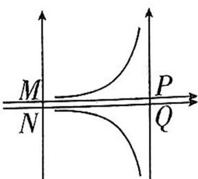

<!-- question-source:start -->
4 [2024 河北沧州期末]如图, 把函数 $y=\frac{1}{x}(x<0)$ 和函数 $y=-\frac{2}{x}$ $\frac{M}{N}$ $\frac{P}{Q}$ (x<0) 的图象画在同一平面直角坐标系中, 则坐标系的原点可能是 \_\_\_\_ 点.

<!-- question-source:end -->

![[Q00108297A1]]
