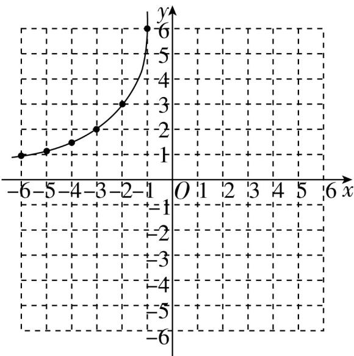

> [!success]- 必刷题
>
> > [!success] **【答案】** 详见解析
>
> > [!note]- **【解析】**
> > 【解】列表：
> >
> > <table><tr><td>x</td><td>...</td><td>-6</td><td>-5</td><td>-4</td><td>-3</td><td>-2</td><td>-1</td><td>...</td></tr><tr><td>y</td><td>...</td><td>1</td><td> $\frac{6}{5}$ </td><td> $\frac{3}{2}$ </td><td>2</td><td>3</td><td>6</td><td>...</td></tr></table>
> >
> > 函数图象如图：
> >
> > 
