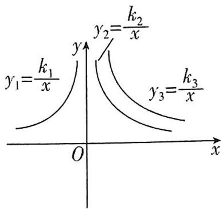

<!-- question-source:start -->
2 [2025 宁夏中卫校级质检]如图是三个反比例函数 $y_{1}=\frac{k_{1}}{x}, y_{2}=\frac{k_{2}}{x},$ $y_{3}=\frac{k_{3}}{x}$ 在 x 轴上方的图

象,由此观察得到 $k_{1}, k_{2}, k_{3}$ 的大小关系为 ( )
A. $k_{1} > k_{2} > k_{3}$ B. $k_{3} > k_{1} > k_{2}$ C. $k_{2} > k_{3} > k_{1}$ D. $k_{3} > k_{2} > k_{1}$
<!-- question-source:end -->

![[Q00108193A1]]
