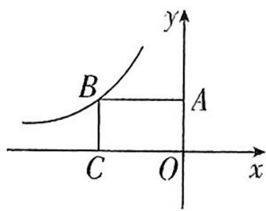
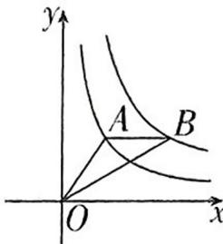

<!-- question-source:start -->
5 [2025 山东青岛校级期末]已知反比例函数 $y = \frac{k}{x} (x < 0)$ 的图象如图所示,若矩形 $OABC$ 的面积为 4 ,则 $k$ 的值是 ( )
A. 2 B. -2 C. 4 D. -4

(第 5 题图)
(第6题图)
<!-- question-source:end -->

![[Q00108196A1]]
