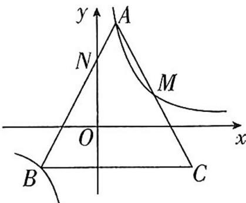

<!-- question-source:start -->
3 [2024 四川宜宾中考, 中] 如图, 等腰三角形

ABC 中, AB = AC, 反比例
函数 $y = \frac{k}{x} (k \neq 0)$ 的图
象经过点 A, B 及 AC 的中点 M, BC // x 轴, AB 与

y轴交于点N.则 $\frac{AN}{AB}$ 的值为 ( )
A. $\frac{1}{3}$ B. $\frac{1}{4}$ C. $\frac{1}{5}$ D. $\frac{2}{5}$
<!-- question-source:end -->

![[Q00108201A1]]
