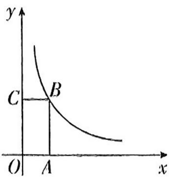

<!-- question-source:start -->
5[2024 广东广州中考,较难]如图,平面直角坐

标系 $xOy$ 中, 矩形 $OABC$ 的顶点 $B$ 在函数 $y = \frac{k}{x} (x > 0)$ 的图象上, $A(1,0), C(0,2)$ . 将线段 $AB$ 沿 $x$ 轴正方向平移得线段 $A'B'$ (点 $A$ 平

移后的对应点为 $A'$ ， $A'B'$ 交函数 $y = \frac{k}{x} (x > 0)$ 的图象于点 $D$ , 过点 $D$ 作 $DE \perp y$ 轴于点 $E$ , 则下列结论: ① $k = 2$ ; ② $\triangle OBD$ 的面积等于四边形 $ABDA'$ 的面积; ③ $A'E$ 的最小值是 $\sqrt{2}$ ; ④ $\angle B'BD = \angle BB'O$ . 其中正确的结论有 \_\_\_\_. (填序号)

2刷素养 ▶ 走向重高
<!-- question-source:end -->

![[Q00108203A1]]
