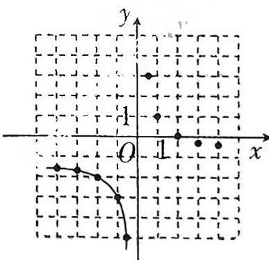

<!-- question-source:start -->
6 核心素养 模型观念 [中] 某数学兴趣小组在学习了反比例函数的图象与性质后, 进一步研究了函数 $y = \frac{2 - x}{x}$ 的图象与性质, 其探究过程如下: (1) 列表: 下表是 $x$ 与 $y$ 的几组对应值, 其中 $m =$ \_\_\_\_;

<table><tr><td>x</td><td>...</td><td>-4</td><td>-3</td><td>-2</td><td>-1</td><td> $-\frac{1}{2}$ </td><td> $\frac{1}{2}$ </td><td>1</td><td>2</td><td>3</td><td>4</td><td>...</td></tr><tr><td>y</td><td>...</td><td> $-\frac{3}{2}$ </td><td> $-\frac{5}{3}$ </td><td>-2</td><td>-3</td><td>-5</td><td>3</td><td>1</td><td>m</td><td> $-\frac{1}{3}$ </td><td> $-\frac{1}{2}$ </td><td>...</td></tr></table>

描点:根据表中各组对应值 $(x,y)$ ，在平面直角坐标系中描出了各点；

连线: 如图, 用平滑的曲线顺次连接各点, 画出了部分图象. 请你把图象补充完整.

(2) 观察图象并分析表格, 回答下列问题;

①当 x<0 时, y 随 x 增大而 \_\_\_\_;

②函数 $y=\frac{2-x}{x}$ 的图象是由函数 $y=\frac{2}{x}$ 的图象向 \_\_\_\_ 平移 \_\_\_\_ 个单位长度而得到；

③函数 $y=\frac{2-x}{x}$ 的图象关于点 \_\_\_\_ 成中心对称；

④不等式 $\frac{2-x}{x}\leq1$ 的解集是\_\_\_\_.

(3) 设 $A(x_{1}, y_{1}), B(x_{2}, y_{2})$ 是函数 $y = \frac{2 - x}{x}$ 的图象上的两点, 且 $x_{1} + x_{2} = 0$ , 试求 $y_{1} + y_{2} + 3$ 的值.

电子错题本鸭
<!-- question-source:end -->

![[Q00108204A1]]
