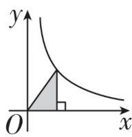
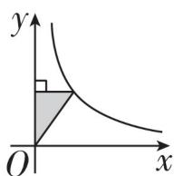
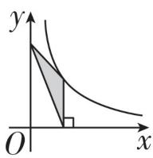
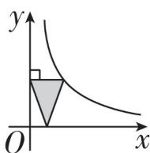
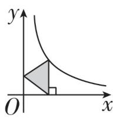
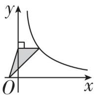
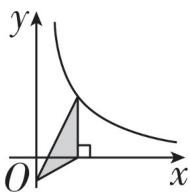
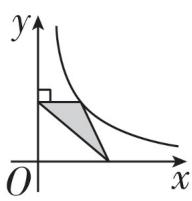

> [!success]- 必刷题
>
> > [!success] **【答案】** D
>
> > [!note]- **【解析】**
> > ∵ 矩形 OABC 的面积为 4, ∴ |k| = 4. 根据图象可知 k < 0, ∴ k = -4. 故选 D.
> >
> > 6.3
> >
> > 模型归纳 | 反比例函数中 $k$ 的几何意义
> > 函数 $y = \frac{k}{x} (k > 0, x > 0)$ 图象如图, 阴影部分的面积均等于 $\frac{1}{2} k$ .
> >
> > 
> >
> > 
> >
> > 
> >
> > 
> >
> > 
> >
> > 
> >
> > 
> >
> > 
> >
> > 【解析】延长 $BA$ 交 $y$ 轴于点 $C$ . $\because \triangle OAB$ 的顶点 $A, B$ 分别在反比例函数 $y = \frac{k}{x} (x > 0)$ 和 $y = \frac{9}{x} (x > 0)$ 的图象上，且 $AB \parallel x$ 轴， $\therefore S_{\triangle OAB} = S_{\triangle BOC} - S_{\triangle AOC} = \frac{9}{2} - \frac{k}{2} = 3$ ，解得 $k = 3$ .
> >
> > ## 刷易错·
> >
> > 易错警示
> > 反比例函数中,
> > 利用函数的增
> > 减性比较函数
> > 值的大小时,一
> > 定要看点所在
> > 的象限. 因为反
> > 比例函数的图
> > 象是双曲线,图
> > 象分布在两个
> > 象限,在不同的
> > 象限,函数值的
> > 正负性不同.
