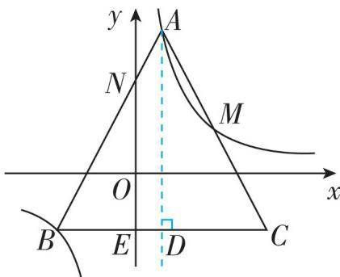

> [!success]- 必刷题
>
> > [!success] **【答案】** B
>
> > [!note]- **【解析】**
> > 过点 A 作 BC 的垂线, 垂足为 D,
> >
> > 设 BC 与 y 轴交于 E 点, 如图. 在等腰三角形 ABC 中, $AD \perp BC$ , $\therefore D$ 是 BC 中点. 根据题意, 设 $A\left(a, \frac{k}{a}\right)$ , $B\left(b, \frac{k}{b}\right)$ ,
> >
> > 
> >
> > 则在等腰三角形 ABC 中, BD = DC = a - b, $\therefore C\left(2a-b,\frac{k}{b}\right)$ . $\because AC$ 的中点为 M, $\therefore M\left(\frac{3a-b}{2},\frac{k(a+b)}{2ab}\right)$ . 由点 M 在反比例函数 $y=\frac{k}{x}(k\neq0)$ 的图象上得 $M\left(\frac{3a-b}{2},\frac{k}{\frac{3a-b}{2}}\right)$ , $\therefore \frac{k(a+b)}{2ab} = \frac{k}{\frac{3a-b}{2}}$ , 解得 $b = -3a (a = b \text{ 已舍去})$ . 由题可知 $AD \parallel NE, \therefore \frac{AN}{AB} = \frac{DE}{BD} = \frac{a}{a-b} = \frac{a}{a+3a} = \frac{1}{4}$ .
> >
> > 故选 **B**.
