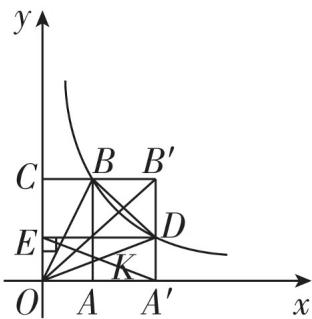

> [!success]- 必刷题
>
> > [!success] **【答案】** ①②④
>
> > [!note]- **【解析】**
> > ∵ A(1,0), C(0,2), 四边形
> >
> > OABC 是矩形, $\therefore B(1,2)$ , $\therefore k=1\times2=2$ , 故①正确, 符合题意. 如图, 设 OD 与 AB 的交点为 K. $\because S_{\triangle AOB}=S_{\triangle A'OD}=\frac{1}{2}\times2=1,\therefore S_{\triangle BOK}=$
> >
> > 
> >
> > $$
> > S _ {\text {四边形} A K D A ^ {\prime}}, \therefore S _ {\triangle B O K} + S _ {\triangle B K D} = S _ {\text {四边形} A K D A ^ {\prime}} + S _ {\triangle B K D},
> > $$
> >
> > $\therefore S_{\triangle OBD} = S_{\text{四边形}ABDA'}$ ，即 $\triangle OBD$ 的面积等于四边形 $ABDA'$ 的面积，故②正确，符合题意. $\because DE \perp y$ 轴， $\angle DA'O = \angle EOA' = 90^\circ$ ， $\therefore$ 四边形 $A'DEO$ 为矩形， $\therefore A'E = OD$ ， $\therefore$ 当 $OD$ 的值最小时， $A'E$ 的值最小. 设 $D\left(x, \frac{2}{x}\right) (x > 0)$ ， $\therefore OD^2 = x^2 + \frac{4}{x^2}$ . $\because \left(x - \frac{2}{x}\right)^2 = x^2 - 2 \cdot x \cdot \frac{2}{x} + \frac{4}{x^2} \geqslant 0, \therefore x^2 + \frac{4}{x^2} \geqslant 4, \therefore OD \geqslant 2, \therefore A'E$ 的最小值为 2，故③错误，不符合题意. 设 $BB' = n$ ，则 $B'(n+1, 2)$ ， $OA' = n+1, \therefore A'B' = 2$ . $\because$ 易得四边形 $A'B'CO$ 为矩形， $\therefore \angle BB'D = \angle OA'B' = 90^\circ$ ， $D\left(n+1, \frac{2}{n+1}\right), \therefore B'D = 2 - \frac{2}{n+1} = \frac{2n}{n+1}$ $\therefore \frac{BB'}{OA'} = \frac{n}{n+1} = \frac{\frac{2n}{n+1}}{2} = \frac{B'D}{A'B'}$ ， $\therefore \triangle B'BD \sim \triangle A'OB'$ ， $\therefore \angle B'BD = \angle B'OA'$ . $\because B'C // A'O, \therefore \angle BB'O = \angle A'OB'$ ， $\therefore \angle B'BD = \angle BB'O$ ，故④正确，符合题意. 故答案为①②④.
> >
> > ## 刷素养·
