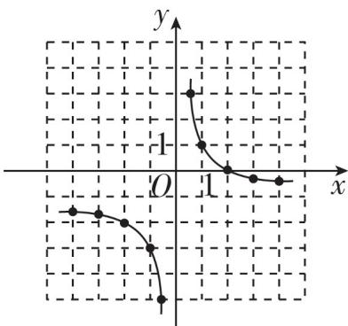

> [!success]- 必刷题
>
> > [!success] **【答案】** 0
>
> > [!note]- **【解析】**
> > 【解】(1) 当 $x = 2$ 时, $y = \frac{2 - 2}{2} = 0$ , $\therefore m = 0$ , 故答案为 0. 补全的图象如图所示. (2)①当 $x < 0$ 时, $y$ 随 $x$ 增大而减小.
> >
> > 
> > - **②**：$y=\frac{2-x}{x}=\frac{2}{x}-1,\therefore$ 函数 $y=\frac{2-x}{x}$ 的图象是由函数 $y=\frac{2}{x}$ 的图象向下平移1个单位长度而得到.
> > - **③**：∵ $y=\frac{2}{x}$ 的图象关于原点成中心对称，∴ $y=\frac{2-x}{x}$ 的图象关于(0,-1)成中心对称.
> > - **④**：由图象可知， $\frac{2-x}{x}\leqslant1$ 时，x<0或 $x\geqslant1$ .故答案为①减小；
> > - **②**：下，1；
> > - **③**：$(0,-1)$ ；
> > - **④**：x<0或 $x\geqslant1$ .
> > (3) 把 $A(x_{1},y_{1})$ , $B(x_{2},y_{2})$ 代入函数 $y=\frac{2-x}{x}$ ,
> > 得 $y_{1}=\frac{2-x_{1}}{x_{1}}=\frac{2}{x_{1}}-1, y_{2}=\frac{2-x_{2}}{x_{2}}=\frac{2}{x_{2}}-1.\because x_{1}+$
> >
> > 思路分析根据反比例函数图象上点的坐标特征判断①, 根据反比例函数 k 的几何意义判断②, 根据矩形的性质判断③④即可.
> >
> > 关键点拨
> > 本题考查了反比例函数与一次函数图象的交点问题, 运用数形结合的思想并利用待定系数法求出直线的函数表达式是解题关键.
> >
> > $x_{2} = 0, \therefore y_{1} + y_{2} + 3 = \frac{2}{x_{1}} - 1 + \frac{2}{x_{2}} - 1 + 3 = \frac{2(x_{1} + x_{2})}{x_{1}x_{2}} + 1 = 1.$
