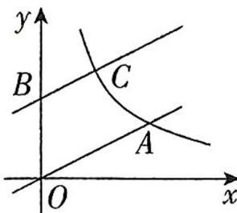

<!-- question-source:start -->
1 [2024 吉林长春中考, 中] 如图, 在平面直角坐标系中, 点 $O$ 是坐标原点, 点 $A(4, 2)$ 在函数 $y =$

$\frac{k}{x} (k > 0, x > 0)$ 的图象上. 将直线 $OA$ 沿 $y$ 轴向上平移, 平移后的直线与 $y$ 轴交于点 $B$ , 与

函数 $y=\frac{k}{x}(k>0,x>0)$ 的图象交于点 C. 若 BC= $\sqrt{5}$ ，则点 B 的坐标是
A. $(0,\sqrt{5})$ B. $(0,3)$ C. $(0,4)$ D. $(0,2\sqrt{5})$
<!-- question-source:end -->

![[Q00108222A1]]
