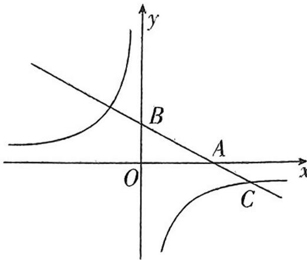

<!-- question-source:start -->
3[2023 四川眉山中考, 中]如图, 在平面直角坐标系 $xOy$ 中, 直线 $y = kx + b$ 与 $x$ 轴交于点 $A(4,0)$ , 与 $y$ 轴交于点 $B(0,2)$ , 与反比例函数 $y = \frac{m}{x}$ 在第四象限内的图象交于点 $C(6,a)$ .

(1) 求反比例函数的表达式；

(2) 当 $kx + b > \frac{m}{x}$ 时, 直接写出 $x$ 的取值范围;

(3) 在双曲线 $y = \frac{m}{x}$ 上是否存在点 $P$ , 使 $\triangle ABP$

建议用时 30 分钟 答案 D63

是以点 A 为直角顶点的直角三角形？若存在，求出点 P 的坐标；若不存在，请说明理由。

<!-- question-source:end -->

![[Q00108224A1]]
