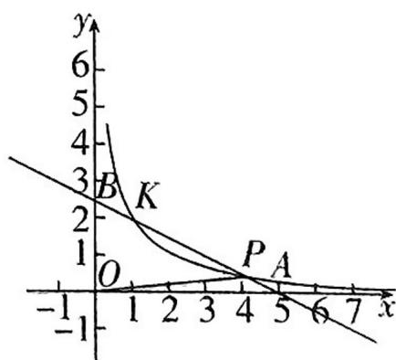
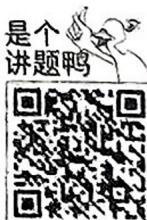

<!-- question-source:start -->
4 [较难] 如图, 在平面直角坐标系中, 已知一次函数 $y_{1} = k_{1}x + b$ 的图象与坐标轴分别交于 $A(5,0), B\left(0, \frac{5}{2}\right)$ 两点, 且与反比例函数 $y_{2} = \frac{k_{2}}{x}$ 的图象在第一象限内交于 $P, K$ 两点, 连接 $OP, \triangle OAP$ 的面积为 $\frac{5}{4}$ .

(1)求一次函数与反比例函数的表达式;

(2) 若 $C$ 为线段 $OA$ 上的一个动点, 当 $PC + KC$ 最小时, 求 $\triangle PKC$ 的面积.

是个新“烤”鸭

电子错题本鸭
<!-- question-source:end -->

![[Q00108225A1]]
